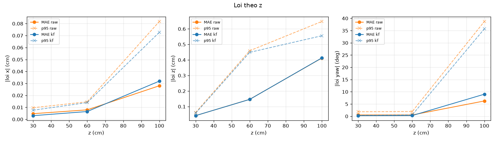
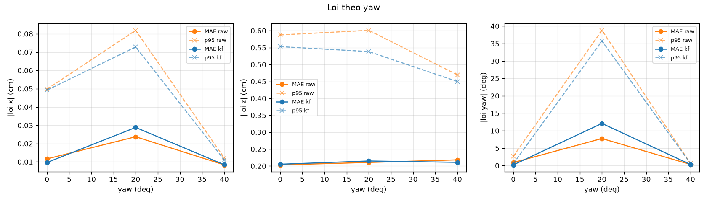

# Ket qua danh gia (gt_runs_render.csv)

> **MO PHONG RENDER**: video marker do camera ao chieu ra, ArUco/PnP/Kalman chay that tren tung frame; GT va K thuoc camera ao (test_p4_e2e.py). KHONG phai phep do bang thuoc, khong suy ra do chinh xac camera that.

Tong 420 frame, 12 tu the luoi, ti le nhan dien luoi 100.0%. Sai so GT gia dinh: +-0.2 cm, +-2.0 deg.

## (a) Loi theo khoang cach z

| gt_z | n | found_% | MAE_raw_x | p95_raw_x | MAE_kf_x | p95_kf_x | MAE_raw_z | p95_raw_z | MAE_kf_z | p95_kf_z | MAE_raw_yaw | p95_raw_yaw | MAE_kf_yaw | p95_kf_yaw |
| --- | --- | --- | --- | --- | --- | --- | --- | --- | --- | --- | --- | --- | --- | --- |
| 30.00 | 90 | 100.00 | 0.00 | 0.01 | 0.00 | 0.01 | 0.04 | 0.06 | 0.04 | 0.06 | 0.54 | 1.86 | 0.25 | 0.36 |
| 60.00 | 150 | 100.00 | 0.01 | 0.01 | 0.01 | 0.01 | 0.15 | 0.46 | 0.15 | 0.45 | 0.53 | 1.94 | 0.29 | 0.55 |
| 100.00 | 120 | 100.00 | 0.03 | 0.08 | 0.03 | 0.07 | 0.41 | 0.65 | 0.41 | 0.56 | 6.26 | 38.73 | 9.02 | 35.73 |

## (a) Loi theo yaw

| gt_yaw | n | found_% | MAE_raw_x | p95_raw_x | MAE_kf_x | p95_kf_x | MAE_raw_z | p95_raw_z | MAE_kf_z | p95_kf_z | MAE_raw_yaw | p95_raw_yaw | MAE_kf_yaw | p95_kf_yaw |
| --- | --- | --- | --- | --- | --- | --- | --- | --- | --- | --- | --- | --- | --- | --- |
| 0.00 | 180 | 100.00 | 0.01 | 0.05 | 0.01 | 0.05 | 0.20 | 0.59 | 0.21 | 0.55 | 0.86 | 2.66 | 0.19 | 0.52 |
| 20.00 | 90 | 100.00 | 0.02 | 0.08 | 0.03 | 0.07 | 0.21 | 0.60 | 0.21 | 0.54 | 7.75 | 38.79 | 12.08 | 35.73 |
| 40.00 | 90 | 100.00 | 0.01 | 0.01 | 0.01 | 0.01 | 0.22 | 0.47 | 0.21 | 0.45 | 0.30 | 0.58 | 0.29 | 0.55 |

## (b) Bieu do

## (c) Do rung dung yen (std trong 30 frame, trung vi qua cac tu the)

| truc | std_raw | std_raw_MAD | std_kf | giam_% |
| --- | --- | --- | --- | --- |
| x (cm) | 0.00 | 0.01 | 0.00 | 86.89 |
| z (cm) | 0.02 | 0.03 | 0.00 | 86.30 |
| yaw (deg) | 0.15 | 0.16 | 0.03 | 83.22 |

## (d) Sigma cua Kalman co dang tin? (ti le |loi| <= 2 sigma)

| truc | trong_2sigma_% | trong_2sigma_co_GT_% | ky_vong_% |
| --- | --- | --- | --- |
| x (cm) | 100.00 | 100.00 | 95.40 |
| z (cm) | 100.00 | 100.00 | 95.40 |
| yaw (deg) | 91.67 | 91.67 | 95.40 |

Neu ti le thap hon nhieu so voi 95%: sigma qua lac quan (R hoac Q qua nho) hoac co loi he thong (bias hieu chuan, kich thuoc marker) ma filter khong biet.

## (e) Do tre tong (capture -> xong filter)

p50 = 6.3 ms, p95 = 8.0 ms (n=420)

## Phan bo status va ca loi

| case | n | found_% | ambiguous_% | reproj_med_px | GOOD_% | DEGRADED_% | LOST_% | MAE_raw_z | MAE_raw_yaw |
| --- | --- | --- | --- | --- | --- | --- | --- | --- | --- |
| fail_occlude | 30 | 0.00 | 0.00 | nan | 0.00 | 50.00 | 50.00 | nan | nan |
| fail_yaw75 | 30 | 100.00 | 0.00 | 0.83 | 100.00 | 0.00 | 0.00 | 0.51 | 1.39 |
| grid | 360 | 100.00 | 5.00 | 0.09 | 93.61 | 6.39 | 0.00 | 0.21 | 2.44 |
