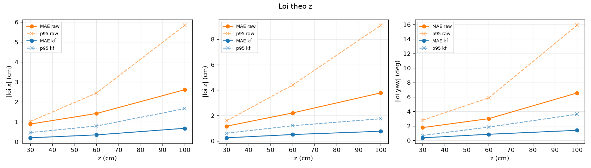
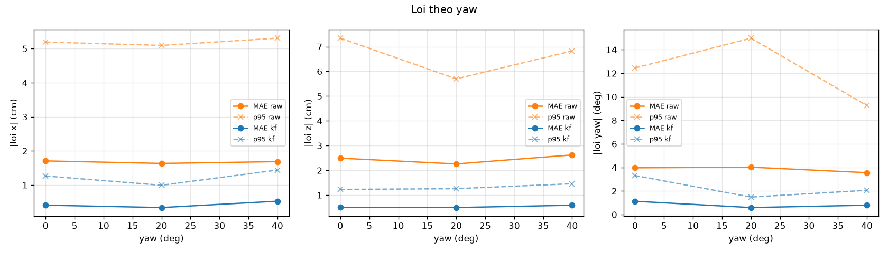

# Ket qua danh gia (gt_runs_synthetic.csv)

> **DU LIEU GIA** tu synthetic.py, chi de kiem tra pipeline. KHONG dung lam bang chung.

Tong 360 frame, 12 tu the luoi, ti le nhan dien luoi 100.0%. Sai so GT gia dinh: +-0.2 cm, +-2.0 deg.

## (a) Loi theo khoang cach z

| gt_z | n | found_% | MAE_raw_x | p95_raw_x | MAE_kf_x | p95_kf_x | MAE_raw_z | p95_raw_z | MAE_kf_z | p95_kf_z | MAE_raw_yaw | p95_raw_yaw | MAE_kf_yaw | p95_kf_yaw |
| --- | --- | --- | --- | --- | --- | --- | --- | --- | --- | --- | --- | --- | --- | --- |
| 30.00 | 90 | 100.00 | 0.89 | 1.02 | 0.20 | 0.46 | 1.16 | 1.58 | 0.24 | 0.60 | 1.78 | 2.80 | 0.36 | 0.69 |
| 60.00 | 150 | 100.00 | 1.42 | 2.44 | 0.35 | 0.79 | 2.20 | 4.39 | 0.50 | 1.19 | 3.01 | 5.88 | 0.85 | 1.85 |
| 100.00 | 120 | 100.00 | 2.61 | 5.83 | 0.68 | 1.66 | 3.78 | 9.09 | 0.76 | 1.75 | 6.55 | 15.88 | 1.40 | 3.61 |

## (a) Loi theo yaw

| gt_yaw | n | found_% | MAE_raw_x | p95_raw_x | MAE_kf_x | p95_kf_x | MAE_raw_z | p95_raw_z | MAE_kf_z | p95_kf_z | MAE_raw_yaw | p95_raw_yaw | MAE_kf_yaw | p95_kf_yaw |
| --- | --- | --- | --- | --- | --- | --- | --- | --- | --- | --- | --- | --- | --- | --- |
| 0.00 | 180 | 100.00 | 1.71 | 5.19 | 0.41 | 1.26 | 2.49 | 7.34 | 0.50 | 1.23 | 3.97 | 12.45 | 1.13 | 3.31 |
| 20.00 | 90 | 100.00 | 1.63 | 5.10 | 0.34 | 0.99 | 2.26 | 5.70 | 0.50 | 1.26 | 4.02 | 14.98 | 0.59 | 1.48 |
| 40.00 | 90 | 100.00 | 1.69 | 5.31 | 0.53 | 1.44 | 2.62 | 6.83 | 0.59 | 1.46 | 3.56 | 9.25 | 0.79 | 2.06 |

## (b) Bieu do

## (c) Do rung dung yen (std trong 30 frame, trung vi qua cac tu the)

| truc | std_raw | std_raw_MAD | std_kf | giam_% |
| --- | --- | --- | --- | --- |
| x (cm) | 3.07 | 1.28 | 0.37 | 88.08 |
| z (cm) | 4.31 | 2.15 | 0.46 | 89.45 |
| yaw (deg) | 6.32 | 2.86 | 0.85 | 86.49 |

## (d) Sigma cua Kalman co dang tin? (ti le |loi| <= 2 sigma)

| truc | trong_2sigma_% | trong_2sigma_co_GT_% | ky_vong_% |
| --- | --- | --- | --- |
| x (cm) | 91.94 | 95.83 | 95.40 |
| z (cm) | 98.06 | 98.89 | 95.40 |
| yaw (deg) | 100.00 | 100.00 | 95.40 |

Neu ti le thap hon nhieu so voi 95%: sigma qua lac quan (R hoac Q qua nho) hoac co loi he thong (bias hieu chuan, kich thuoc marker) ma filter khong biet.

## (e) Do tre tong (capture -> xong filter)

p50 = 6.1 ms, p95 = 7.9 ms (n=360)

## Phan bo status va ca loi

| case | n | found_% | ambiguous_% | reproj_med_px | GOOD_% | DEGRADED_% | LOST_% | MAE_raw_z | MAE_raw_yaw |
| --- | --- | --- | --- | --- | --- | --- | --- | --- | --- |
| grid | 360 | 100.00 | 0.00 | 0.37 | 95.28 | 4.72 | 0.00 | 2.47 | 3.88 |
